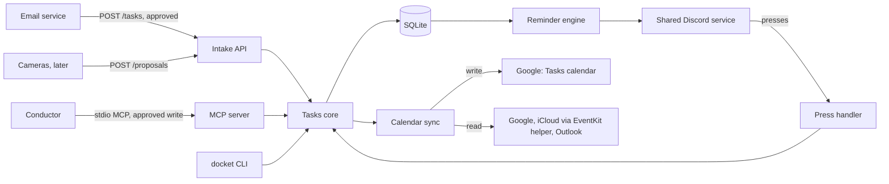

# Architecture

Status: see `docs/roadmap.md`.

## Goal

`docket` is the single source of truth for tasks, reminders and calendar sync for one person. Tasks arrive already approved (from the email service or Conductor), as proposals you approve on a card, or from you directly. The app reminds you until each task is done or cancelled, and writes approved deadlines to one calendar.

## Principles

1. **Nothing without approval.** A task exists only after an approval by you: in the source that sent it, on the app's own proposal card, or by your own command. The app never creates or edits a task on a timeout, from a calendar change, or by guessing.
2. **No model.** Every rule is code. The app makes no model call and holds no prompt.
3. **A reminder is never lost.** Reminders are rows in a table with a fire time and a sent time; a loop sends what is due. Nothing lives in memory, so a restart, a crash or an outage only delays a reminder.
4. **Everything is retry-safe.** Every create is keyed, every send is claimed before it goes out, and every button press is safe to repeat.
5. **One code path per action.** A Done press, `docket done`, and Conductor's `complete_task` all call the same function and write the same audit row.
6. **Least data out.** The calendar receives only an approved title and time. Discord receives only titles, times and fixed text.

## Components



| Component | Job |
| --- | --- |
| Tasks core | Creating, changing and ending tasks; the state rules; the audit log. Every other component calls it |
| Intake API | FastAPI on 127.0.0.1: approved tasks, follow-up links, proposals. Each client signs in with its own token |
| MCP server | `docket mcp serve` on stdio for Conductor: read tools and approved write tools |
| Reminder engine | Plans reminders for each task, and every 30 seconds sends what is due through the Discord service |
| Press handler | Receives button presses forwarded by the Discord service and calls the core |
| Calendar sync | Writes due-date events to the Tasks calendar through a queue; reads every connected calendar live |
| CLI | `docket` commands: run the service, sign in to calendars, list and change tasks, decide proposals. From Phase 1e: `docket tasks add`, `list` and `show`; from Phase 1f: `start`, `done`, `cancel` and `reopen` (a repeat says so and exits 0); from Phase 1g: `edit` (title and deadline) and `plan` (the work time); each needs `DOCKET_TIME_ZONE`, writes only through `docket.core`, and refuses with a plain sentence on stderr and exit code 1 |

## Stack

| Concern | Choice | Notes |
| --- | --- | --- |
| Language | Python 3.12 (`/opt/homebrew/bin/python3.12`) | |
| Storage | Standard library `sqlite3`, plain SQL, numbered migrations tracked in `PRAGMA user_version` | As in the email service |
| API | FastAPI 0.162 on 127.0.0.1, port `DOCKET_WEB_PORT` (default 8767), its own telemetry switched off in code (Phase 2c) | Host check (`127.0.0.1:<port>` and `localhost:<port>` only), as in `finances` and Conductor |
| Outgoing HTTP | httpx | Google, Microsoft Graph, the Discord service |
| Agent tools | `mcp` Python SDK 2.x, stdio | The same SDK as `finances` and Conductor |
| Settings | `pydantic-settings`, prefix `DOCKET_` | |
| Commands | `typer` | |
| Secrets | The login Keychain, service `docket`, through `docket.keychain` | Client tokens, calendar refresh tokens |
| Tests and lint | `pytest`, `pytest-cov`, `ruff` | |

The data folder is `DOCKET_DATA_DIR`, by default `~/Library/Application Support/docket`, mode `0700`; the database file is `docket.sqlite3`, mode `0600`. Unlike the email service's data, it holds no email text, so it is backed up by Time Machine.

## Data model

| Table | Holds |
| --- | --- |
| `tasks` | id, title (plain text, at most 100 characters), state, deadline (UTC instant and IANA zone, or none), whether a time was given, planned work time (start as a UTC instant and zone, and length in minutes, or none), source (`email`, `agent`, `proposal`, `owner`), the source's reference (for email: provider, message id, link), created and updated times |
| `request_keys` | Each keyed request's client and key (unique per client), its request as canonical JSON, and the task (and link) it made (migration 2) |
| `links` | Follow-up emails on a task (the email service's `/links`): provider, message id, link, ids `l1`, `l2` (migration 2). Links and keys of tasks ended more than a year ago are pruned by the service |
| `proposals` | source, title, optional deadline, evidence quote, confidence, state (pending, approved, declined), the task it became |
| `reminders` | task, kind, fire time, claimed time, sent time, voided time, and held (waiting on a calendar question) |
| `calendar_links` | task, kind (`deadline` or `work`), calendar, event id, the title and time last written, last checked |
| `calendar_queue` | Event writes waiting to be sent, retried each round |
| `posts` | Each card sent to Discord: what it is for, its message id once posted, whether it was answered |
| `alerts`, `problems` | As in the email service: each problem once when it starts and once when it is fixed |
| `audit_log` | Every change: when (UTC), what, who or what caused it (press, command, agent, email), before and after |

Task ids are `t` followed by the row's number (`t1`, `t2`), given out in order and never reused once committed; they fit the email service's rule (ASCII letters, digits, `-` and `_`). Titles are 1 to 100 characters with no leading or trailing whitespace and no control, format or line-separator characters (Unicode categories Cc, Cf, Zl, Zp); a title that breaks the rule is refused, never rewritten.

Phase 2g specifies email references as plain text: `message_id` is 1–512 Unicode code points and `link` is 1–2,048, with no Cc, Cf, Zl or Zp characters. Neither field is trimmed, normalized or parsed as a URL. `docket.references` supplies the pure policy to core and the upgrade preflight. Migration 3 bounds stored lengths and prevents NUL length bypasses, rebuilding tasks and links without changing IDs, audit rows, retry JSON or sequences. Invalid legacy references stop the upgrade with `invalid stored reference: <task/link id> <field>`; no automatic repair is performed. Foreign keys are disabled only for that rebuild and restored on every exit.

The store (`docket.store`, Phase 1b) is one SQLite file, `docket.sqlite3`, mode `0600`, in WAL mode with a 5-second busy timeout, so the service, the `docket` command and the MCP server can each open it. Every write runs inside `Store.transaction()` (`BEGIN IMMEDIATE`), so a change and its audit row commit together or not at all. Tasks are never deleted and audit rows never changed or removed; triggers enforce both.

Phase 2i specifies a startup gate at `path.with_name(path.name + ".startup.lock")` (normally `docket.sqlite3.startup.lock`), empty and mode 0600. An exclusive standard-library flock is acquired before SQLite opens, held through WAL/setup/migrations and failed-constructor cleanup, then released. The gate waits until the initializer finishes; SQLite keeps its own five-second busy timeout. The file is retained, never unlinked as stale; the OS releases the lock when its process exits. Normal writes continue through SQLite, outside this startup gate. Gate acquisition failures report only `store startup unavailable`.

Schema-version decisions and each migration's fresh eligibility check run under `BEGIN IMMEDIATE`, preserving individual migration transactions and migration-3-only foreign-key relaxation. Every failed initialization closes its created connection once, without double-closing the reference rebuild path. Phase 2i adds no migration or setting.

When a task is loaded, Phase 2i requires UTC deadline/work instants and created/updated timestamps, plus exact deadline/work zones. Invalid data raises `invalid stored task time: <task id>` without a library-error chain; it is not normalized, repaired or omitted from a requested result. The CLI's private store context guard handles these read failures as plain stderr refusals, with no partial output. Audit/link/request-key timestamp decoding is outside this phase.

Phase 2j specifies one private core helper for inserting an open task and its complete create audit snapshot, called directly by both public creation functions. Validation, the single timestamp, transaction and retry-key decisions remain with each public caller. The helper never opens a transaction or reads the clock. `docket.serialization.canonical_json(value: dict[str, object]) -> str` becomes the shared writer for audit snapshots, saved request bodies and both sides of task/link retry comparisons. It preserves the existing `json.dumps` options: sorted keys, unescaped Unicode and compact separators, with all other defaults unchanged. Store decoding remains local; no schema or public core/store contract changes.

## Task states

Stored states are **open**, **in progress**, **done** and **cancelled**. **Due** (at or after the deadline, within the first late reminder) and **overdue** (later) are worked out from the deadline and the clock when read; they are never stored. Time passing can make a task overdue but never done.

| From | Event | To |
| --- | --- | --- |
| open | Working on it | in progress |
| open, in progress | Done | done |
| open, in progress | Cancel | cancelled |
| done, cancelled | Reopen | open (any time; its reminders are planned again) |
| done, cancelled | anything else | no change; the press is answered with the task's state |

Only done and cancelled stop reminders. A new deadline, a new work time, a snooze or a title edit keeps the state.

`docket.core` (Phase 1c) is the only code that creates or changes a task: `create_task`, `change_state` (start, done, cancel, reopen) and `edit_task` (title, deadline, work time). Each runs in one store transaction with its audit rows; a repeat (Done on a done task, the same title again) reports no change and writes nothing. An ended task must be reopened before an edit, a change that leaves a work time ending after the deadline is refused, and past dates are allowed. Refusals are constant codes: `unknown_task`, `invalid_title`, `invalid_source`, `invalid_reference`, `invalid_actor`, `invalid_action`, `task_ended`, `work_after_deadline`.

## Time rules (`docket.deadlines`, critical)

- A deadline is a UTC instant plus the IANA zone it was given in, named exactly as `zoneinfo.available_timezones()` lists it. It is a fixed instant: travelling does not move it.
- A wall time that doesn't exist (the spring-forward hour) moves forward; one that happens twice (the fall-back hour) is the first. Both are Python's `fold=0`.
- A deadline is upcoming before its instant, due for the 30 minutes after it (until the first late reminder), then overdue.
- A date with no time gets 17:00 in the given zone. The task remembers that no time was given, and cards show "Fri Nov 20 (17:00, no time given)".
- A planned work time is a start instant plus a length of 5 to 720 real minutes (default `DOCKET_WORK_MINUTES`, 60), on one day. It must end by midnight of that day in its zone, and by the deadline when there is one. A task has at most one planned work time.
- Times are shown in your zone (`DOCKET_TIME_ZONE`, which has no default: a command that needs it refuses with `DOCKET_TIME_ZONE is not set`), and also in the zone a deadline or work time was set in when that differs: `Fri Nov 20 17:00 EST (Sat Nov 21 07:00 JST where set)`. Names are English whatever the locale, the year appears only when it isn't this year, and a deadline with no time given says so. `docket.views` (Phase 1d) is the one place that writes this text.
- Every offset (1 hour before, 30 minutes after) is computed from the stored instant. Days, such as the daily digest, are counted in your zone (`DOCKET_TIME_ZONE`), so daylight-saving changes never shift a reminder.

## Intake

### Approved tasks (the email service's contract)

`POST /tasks` with `Authorization: Bearer <client token>` and `Idempotency-Key: <key>`, and a JSON body:

| Field | Notes |
| --- | --- |
| source | Must be the source the token allows (`email` for the email service) |
| title | 1 to 100 characters of plain text |
| deadline | `null`, or `date` (YYYY-MM-DD), `time` (HH:MM or `null`) and `time_zone` |
| provider, message_id, link | The email's reference, stored with the task |

- Built in `docket.intake` (Phase 2b, no HTTP): `accept_task` and `accept_link` return the status and body below; every refusal body is `{"error": <code>}`, and every text field must be a JSON string.
- Phase 2f requires an explicit keyword-only `client` on both intake functions, with no default. HTTP passes the identity matched to the bearer token; the body never supplies it. These routes remain email-only: after checking the retry key, intake refuses any non-string or non-email identity with 422 `invalid_client`, before looking up a task or parsing the body. Missing or unmatched tokens remain 401 `unauthorized`. Valid agent writes still go directly through the core, later through MCP; no agent HTTP client is enabled.
- Phase 2h specifies a bounded stream read before JSON parsing: at most 65,536 actual bytes, with no reliance on Content-Length and no read after the decisive overflow chunk. Once size, key and JSON are checked, one awaited framework worker call opens the store, invokes intake with the matched client, and closes the store on that same thread. SQLite waits leave the event loop free; the existing 5-second busy timeout and connection thread checks stay in force. Responses, validation order and retry records are unchanged. No executor, queue or new dependency is added.
- **201** `{"id": ...}` for a new task; **200** with the same id when the key is sent again with the same body; **409** when the key is sent again with a different body; **400** for a missing `Idempotency-Key` (1 to 200 characters); **401** for a missing or wrong token; **422** for an invalid body (exactly the fields above; a title of one line). These match the email service's `FakeTasksApp`, plus 401.
- The task is created **open**, its reminders are planned and its calendar write is queued, all in one transaction.

`POST /tasks/<id>/links` adds a follow-up email to a task, keyed the same way, with exactly `source`, `provider`, `message_id` and `link`: 201 `{"id": ...}` (the link's id), 200 with the same id on repeats, 409 for the same key with another task or body, 404 for an unknown task.

A token is always required. The email service's stub sends none today; its Phase 3c adds it, so 3c must land before the two are connected.

### Approved tasks from Conductor

Conductor calls `create_task` and the other write tools over MCP only after you approve the step (see [MCP tools](#mcp-tools-for-conductor)). They use the same core function as `POST /tasks`, with source `agent`. Each carries a `request_key` that Conductor's code fills with `<run id>:<step id>`, so a step retried after a timeout updates nothing twice.

### Proposals

`POST /proposals` with a source, title, optional deadline, evidence quote and confidence. A proposal posts a card; only your press (or `docket proposals approve`) makes it a task. One follow-up after 30 minutes, then it waits in the daily digest. Nothing is created on a timeout. No source sends proposals in v1; cameras will.

## Reminder engine (`docket.reminders`, critical)

Each task with a deadline gets planned reminders:

| Kind | When | Message | Buttons |
| --- | --- | --- | --- |
| `before` | 1 hour before | "Are you working on this?" | Working on it, Done, Snooze, Edit deadline |
| `due_soon` | At creation, instead of `before`, when the deadline is under an hour away | "This is due soon." | Working on it, Done, Snooze, Edit deadline |
| `due` | At the deadline | "This is now due." | Done, Need more time, Cancel |
| `late` | 30 minutes and 1 hour after, then hourly 3 times, then every 4 hours twice | "This is late." | Done, New deadline, Cancel |
| `start` | At the planned work time's start | "Time to start." | Working on it, Done, Snooze, Move work time |
| digest | Daily at `DOCKET_DIGEST_TIME` (default 07:00) | Every task past its last late reminder, and every pending proposal | One line each, with Done |

How it runs:

- A loop every 30 seconds **claims** due reminders (sets the claimed time in one statement), sends them, and sets the sent time. A claim older than 5 minutes with no sent time is released, so a crash mid-send retries and a second loop never sends twice.
- After downtime, all reminders that came due while the app was down are sent as **one status message** per task, naming the current state, not one message per missed reminder.
- Done or Cancel voids every pending reminder of the task in the same transaction. Working on it changes the state only; deadline and late reminders continue.
- A new deadline voids the task's pending deadline reminders and plans new ones; a new work time does the same for its `start` reminder. Snooze moves only the next reminder (by `DOCKET_SNOOZE_MINUTES`, default 30) and never the deadline.
- No quiet hours: reminders fire whenever they come due.
- Before sending a reminder for a task with a calendar event, the engine reconciles it (see below).

## Discord through the shared service

The shared Discord service (a separate project, planned) owns the bot token and the Gateway connection. The tasks app never talks to Discord directly.

- **Out:** the app asks the service to post or update a card: channel (the alert channel for reminders, which pings you; the tasks channel for proposals and notices), fixed text, task titles inside code blocks so nothing can format, link or mention, and buttons whose ids the app chooses. The request is keyed, so a retry never posts twice.
- **In:** the service forwards each press to the app's `POST /discord/press` on 127.0.0.1, with its own token, the button id and the presser's Discord user id. The app checks the user id against `DOCKET_OWNER_DISCORD_ID` again, even though the service checks it too.
- **Presses are idempotent.** A press on an old or answered card is answered with the task's current state and changes nothing. Edit deadline and New deadline open a form; the typed deadline is read by code, and anything it cannot read is refused privately.
- **Commands** (`/tasks`, `/done <id>`) call the same core functions as the buttons.
- **The service down:** sends stay queued in the app and are retried; after 15 minutes of failures the app raises a local alert (`docket status`), and one Discord message when sending works again.

## Calendar sync

- **Write path:** creating a task with a deadline or a work time, or changing either or the title, queues one write per event to the Tasks calendar. Each event id is stored with its kind, so a retry updates the event instead of making a second one. Done keeps the events and puts "Done: " in front of their titles; Cancel deletes them. A task with neither a deadline nor a work time never becomes an event.
- **What an event is:** a deadline becomes a due-date event at the deadline with an alert. A planned work time becomes a timed event from its start for its length. The app never adds a work time on its own.
- **Read path:** `list_events` and `check_availability` read live from every connected calendar: Google (each account in settings), iCloud through the EventKit helper, Outlook through Microsoft Graph. A backend that fails is named in the answer, never silently left out.
- **EventKit helper:** a small read-only command-line program on the Mac that prints events for a range as JSON. It never writes. It carries its own embedded Info.plist with the calendar usage text, and the Calendars permission is granted once by running `docket eventkit-setup` from Terminal. Under launchd a missing permission can make the first EventKit call wait forever on a prompt that cannot show, so the app always runs the helper with a timeout and reports a timeout as a failed backend.
- **Reconcile before reminding:** before a reminder for a task with an event, fetch the event. If it moved or was deleted, hold the reminder and ask on Discord ("Keep the deadline", "Use the calendar's time", "Cancel the task"). A check every 20 minutes flags mismatches too. The app never edits a task from a calendar change on its own.
- **Calendar down or token expired:** the task and its reminders are unaffected; writes stay queued and an alert is posted.
- **Calendar alerts are a convenience.** The Discord reminders are the real system, because a calendar cannot ask whether you finished.

## MCP tools for Conductor

`docket mcp serve` on stdio. Read tools carry `readOnlyHint: true`; every tool declares an output schema, as Conductor's tool check requires. Results are plain data: ISO times, ids, titles.

| Tool | Conductor effect | Notes |
| --- | --- | --- |
| `list_tasks(status)` | read | open, in progress, due, overdue, done, cancelled; capped with paging |
| `get_task(id)` | read | With reminder history and the linked event |
| `list_proposals` | read | Pending proposals with their source and evidence |
| `list_events(range)` | read | Across every connected calendar |
| `check_availability(range)` | read | Free and busy across every calendar |
| `create_task(title, deadline, request_key)` | write | An approved task, source `agent` |
| `change_deadline(id, deadline, request_key)` | write | Voids and replans reminders, queues the calendar update |
| `plan_work_time(id, start, minutes, request_key)` | write | Sets or moves the planned work time; the agent picks the time with `check_availability` first |
| `snooze_task(id, minutes, request_key)` | write | Moves the next reminder only |
| `complete_task(id, request_key)` | write | Same path as the Done button |
| `cancel_task(id, request_key)` | write | Same path as Cancel |

No tool approves or declines a proposal. A tool returns refusals as a constant code (`unknown_task`, `already_done`, `invalid_deadline`), never echoing its input.

**Trust boundary.** The app cannot tell whether a stdio caller asked you first; it relies on Conductor's approval policy, as `finances` does for its proposal tools. Every write through MCP is recorded with source `agent` and the request key, and `docket audit` lists them.

## Service runtime

`docket run` runs the API, the reminder loop and the calendar queue in one process, as a launchd LaunchAgent with `RunAtLoad` and `KeepAlive`, like the email service. The Mac never sleeps. `docket status` shows the last loop time, queued sends and open problems.

## Failure handling

| Failure | Outcome |
| --- | --- |
| Discord service unreachable | Sends stay queued and retry; local alert after 15 minutes; one message when fixed |
| Two loops, or a retried send | Claims stop a reminder from posting twice |
| Calendar API down or token expired | Task and reminders unaffected; writes queued; alert |
| EventKit helper hangs or is refused | Timeout; iCloud named as a failed backend in the answer; alert pointing to `docket eventkit-setup` |
| Event moved or deleted | Reminder held; question on Discord |
| Restart or crash | Missed reminders sent as one status message per task |
| Daylight-saving change | Offsets from the stored instant; days in your zone |
| Duplicate create | Same key: same answer. Follow-up email in a known thread: the email service sends a link, not a task |
| A press from anyone else | Ignored, nothing recorded but the attempt |

## Package layout (planned)

```
docket/
  AGENTS.md, CLAUDE.md
  pyproject.toml
  docs/
  scripts/check.py, scripts/check_reports.py, scripts/critical_modules.txt
  src/docket/
    config.py, clock.py, ids.py, keychain.py
    deadlines.py        time rules (critical)
    references.py       email reference text bounds and characters (critical, Phase 2g)
    schema.py, store.py the database: migrations, reads, writes in transactions (critical)
    core.py             create, change, end tasks; audit (critical)
    intake/             the API routes: tasks, links, proposals, presses
    reminders.py        planning and the send loop (critical)
    discord_client.py   the shared Discord service's client
    calendar/           google.py, eventkit.py, graph.py, sync.py, reconcile.py
    mcp_server/         thin tools over core
    service.py          docket run
    cli/                thin Typer commands
  helpers/eventkit/     the read-only EventKit helper
  tests/
```

## Privacy and security boundary

- **No model, no email text.** The app holds titles, times, ids and links. A title that came from an email is plain text of at most 100 characters, treated as data: shown in code blocks on Discord, never as markdown or a link.
- **Network.** The app connects only to the shared Discord service on 127.0.0.1, Google's OAuth and Calendar endpoints, and (from its phase) Microsoft's sign-in and Graph. It listens only on 127.0.0.1. The EventKit helper runs as a child process. No telemetry.
- **Calendar data out.** Only the approved title and the deadline reach the Tasks calendar. Reads bring other events' titles and times into memory for one answer; they are not stored.
- **Least access.** Google: `calendar.app.created` writes only to the calendar the app made; `calendar.calendarlist.readonly` and `calendar.events.readonly` read. Microsoft Graph: `Calendars.ReadBasic`, personal accounts only, which leaves out event bodies. Both are to be confirmed in a spike before their phase.
- **Sign-in.** Every API client has its own Keychain token, and the token fixes which source it may claim. Presses are checked against your Discord user id.
- **Secrets** come only from the Keychain, never from settings, files or logs.
