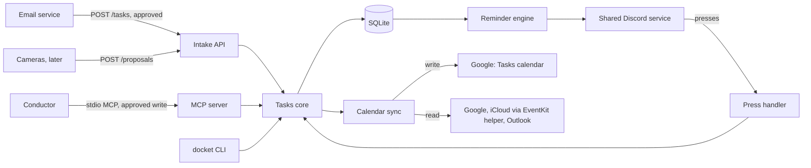

# Architecture

This is the design as it stands. What is built and what comes next is in `docs/roadmap.md`; why each choice was made, with its date, is in `docs/decisions.md`; how a part was built is in its phase spec under `docs/phases/`. Parts not built yet carry the stage that adds them.

## Goal

`docket` is the single source of truth for tasks, reminders and calendar sync for one person. Tasks arrive already approved (from the email service or Conductor), as proposals you approve on a card, or from you directly. The app reminds you until each task is done or cancelled, and writes approved deadlines to one calendar.

## Principles

1. **Nothing without approval.** A task exists only after an approval by you: in the source that sent it, on the app's own proposal card, or by your own command. The app never creates or edits a task on a timeout, from a calendar change, or by guessing.
2. **No model.** Every rule is code. The app makes no model call and holds no prompt.
3. **A reminder is never lost.** Reminders are rows in a table with a fire time and a sent time; a loop sends what is due. Nothing lives in memory, so a restart, a crash or an outage only delays a reminder.
4. **Everything is retry-safe.** Every create is keyed, every send is claimed before it goes out, and every button press is safe to repeat.
5. **One code path per action.** A Done press, `docket done`, and Conductor's `complete_task` all call the same function and write the same audit row.
6. **Least data out.** The calendar receives only an approved title and time. Discord receives only titles, times and fixed text.

## Components



| Component | Job | Built |
| --- | --- | --- |
| Tasks core | Creating, changing and ending tasks; the state rules; the audit log. Every other component calls it | Yes (`docket.core`) |
| Intake API | FastAPI on 127.0.0.1: approved tasks and follow-up links; proposals later. Each client signs in with its own token | Tasks and links (`docket.intake`, `web`, `server`) |
| MCP server | `docket mcp serve` on stdio for Conductor: read tools and approved write tools | Read tools; create, complete and cancel in 6d; change_deadline and plan_work_time in 6e |
| Reminder engine | Plans reminders for each task, and every 30 seconds sends what is due through the notifier | Yes, through a fake notifier (`docket.reminders`) |
| Press handler | Receives button presses forwarded by the Discord service and calls the core | Stage 4 |
| Calendar sync | Writes deadline and work-time events to the Tasks calendar through a queue; reads every connected calendar live | Stages 7 to 9 |
| CLI | `docket` commands; thin, with no decisions | See below |

The CLI today: `docket version`; `docket serve` (the intake API); `docket mcp serve`; `docket clients add <client> [--replace]` (prints a new token once and stores it in the Keychain); and `docket tasks add`, `list [--all]`, `show`, `start`, `done`, `cancel`, `reopen`, `edit` (title and deadline) and `plan` (the work time). Task commands need `DOCKET_TIME_ZONE`, write only through `docket.core`, treat a repeat as no change (exit 0), and refuse with one plain sentence on stderr and exit code 1. `docket run`, `docket status`, `docket audit`, `docket proposals` and the calendar sign-ins come with their stages.

## Stack

| Concern | Choice | Notes |
| --- | --- | --- |
| Language | Python 3.12, run as `.venv/bin/python` | |
| Storage | Standard library `sqlite3`, plain SQL, numbered migrations tracked in `PRAGMA user_version` | As in the email service |
| API | FastAPI on 127.0.0.1, port `DOCKET_WEB_PORT` (default 8767), its own telemetry switched off in code | Host check (`127.0.0.1:<port>` and `localhost:<port>` only), as in `finances` and Conductor |
| Outgoing HTTP | httpx (from Stage 4) | Google, Microsoft Graph, the Discord service |
| Agent tools | `mcp` Python SDK, pinned `>=2.3,<2.4`, stdio | The same SDK as `finances` and Conductor |
| Settings | `pydantic-settings`, prefix `DOCKET_` | `DATA_DIR`, `TIME_ZONE`, `WORK_MINUTES`, `WEB_PORT` today |
| Commands | `typer` | |
| Secrets | The login Keychain, service `docket`, through `docket.keychain` | Client tokens; calendar refresh tokens later |
| Tests and lint | `pytest`, `pytest-cov`, `ruff` | |

The data folder is `DOCKET_DATA_DIR`, by default `~/Library/Application Support/docket`, mode `0700`; the database file is `docket.sqlite3`, mode `0600`. Unlike the email service's data, it holds no email text, so it is backed up by Time Machine.

Settings errors name the setting with a fixed sentence (`DOCKET_TIME_ZONE is not set`, `DOCKET_WEB_PORT must be 1024 to 65535`); when several fail, the first of data folder, time zone, work minutes and port wins, and anything else is `Invalid docket settings.`, never library text.

## Data model

Built tables (migrations 1 to 6):

| Table | Holds |
| --- | --- |
| `tasks` | id, title, state, deadline (UTC instant and IANA zone, or none), whether a time was given, planned work time (start as a UTC instant and zone, and length in minutes, or none), source (`email`, `agent`, `proposal`, `owner`), the source's reference (for email: provider, message id, link), created and updated times |
| `audit_log` | Every change: when (UTC), what, who or what caused it (press, command, agent, email), before and after as canonical JSON |
| `request_keys` | Each keyed request's client and key (unique per client), its request as canonical JSON, and the task (and link) it made |
| `links` | Follow-up emails on a task (the email service's `/links`): provider, message id, link |
| `reminders` | task, kind, fire time, the planning instant, and claimed, sent and voided times |
| `posts`, `post_reminders` | Each notice sent through the notifier: task, retry key, the newest reminder's kind, the missed count, queued, claimed and sent times; each reminder belongs to at most one post. Stage 4 adds the Discord message id and whether it was answered |
| `digests`, `digest_tasks` | One daily digest per home day: its day, retry key, queued, claimed and sent times, and the tasks it was queued with |

Planned tables: `proposals` (Stage 10: source, title, optional deadline, evidence quote, confidence, state, the task it became); `calendar_links` and `calendar_queue` (Stage 7: each event's kind, calendar, id and last written title and time; the writes waiting to be sent); `alerts` and `problems` (Stage 5, as in the email service: each problem once when it starts and once when it is fixed). Reminders gain a held flag in Stage 9.

**Ids.** Internal rows use SQLite-assigned, never-reused row numbers shown with a letter: tasks `t1`, links `l1`, reminders `r1`. Outbound retry keys come from `docket.ids.new_id()`, are stored once with the post or digest they send, and are reused on every attempt. Task ids fit the email service's rule (ASCII letters, digits, `-` and `_`).

**Titles** are 1 to 100 characters with no leading or trailing whitespace and no control, format or line-separator characters (Unicode categories Cc, Cf, Zl, Zp); a title that breaks the rule is refused, never rewritten.

**Email references** are plain text: `message_id` is 1 to 512 code points and `link` 1 to 2,048, with no Cc, Cf, Zl or Zp characters, never trimmed, normalized or parsed as a URL. `docket.references` holds the rule for the core and for the upgrade check.

**Never deleted.** Tasks, audit rows, reminders, posts and digests are never removed, and their contents (a reminder's plan, a post's members) never change; triggers enforce this. Links and keys of tasks ended more than a year ago will be pruned by the service (Stage 5).

## Store (`docket.store`, critical)

- **One file.** `docket.sqlite3` in WAL mode with a 5-second busy timeout, so the API, the CLI, the MCP server and later the service can each open it.
- **One transaction per change.** Every write runs inside `Store.transaction()` (`BEGIN IMMEDIATE`), so a change, its audit row and its reminder rows commit together or not at all.
- **Startup.** An exclusive flock on `docket.sqlite3.startup.lock` (empty, mode `0600`, never removed) is held from before SQLite opens until setup and migrations finish, so two processes never migrate at once; a failure to take it is `store startup unavailable`. Each migration checks the schema version under `BEGIN IMMEDIATE` and runs in its own transaction. A failed start closes its connection.
- **Migrations.** 1 tasks and the audit log; 2 links and request keys; 3 bounds stored references, rebuilding `tasks` and `links` without changing ids, audit rows or keys, and stops with `invalid stored reference: <id> <field>` on a bad legacy row instead of repairing it; 4 reminders, backfilling each open or in-progress task's plan once from its stored state; 5 posts; 6 digests.
- **Table modules.** Each table's SQL lives in a private module (`_store_tasks`, `_store_audit`, `_store_links`, `_store_keys`, `_store_reminders`, `_store_posts`, `_store_digests`) that receives the Store's connection and never opens one, manages a transaction or decodes values. `Store` keeps the public records, the checks and the encoding. Column names come from fixed internal lists; every value is a bound parameter.
- **Stored values are checked when read.** A task, reminder, post or digest whose times are not UTC or whose zone is not exact raises a constant `StoreError` naming only the row (`invalid stored task time: t3`), never repaired, never left out of a result. The CLI shows it as a plain refusal. Audit, link and request-key rows are not checked yet (Phase 5a).
- **One JSON writer.** `docket.serialization.canonical_json` (sorted keys, unescaped Unicode, compact) writes audit snapshots and saved request bodies and compares retries.

## Shared rules

`docket.domain` is the one source for the closed lists and limits: states and their labels, sources and the actor each implies, clients, actions, providers, reminder kinds, the forbidden character categories, and the title, key and work-time bounds. The schema's CHECKs stay literal SQL, and tests compare them with `domain`. `docket.parsing` reads dates (`YYYY-MM-DD`) and times (`HH:MM`) strictly with a fixed-text `ParseError`, which the CLI and intake turn into their own messages. `domain.zone_names()` is the one set of exact zone names.

## Task states

Stored states are **open**, **in progress**, **done** and **cancelled**. **Due** and **overdue** are worked out from the deadline and the clock when read; they are never stored. Time passing can make a task overdue but never done.

| From | Event | To |
| --- | --- | --- |
| open | Working on it | in progress |
| open, in progress | Done | done |
| open, in progress | Cancel | cancelled |
| done, cancelled | Reopen | open (any time; its reminders are planned again) |
| done, cancelled | anything else | no change; the press is answered with the task's state |

Only done and cancelled stop reminders. A new deadline, a new work time, a snooze or a title edit keeps the state.

`docket.core` is the only code that creates or changes a task: `create_task`, `create_task_once` (keyed, for intake and agents), `add_link` (keyed), `change_state` (start, done, cancel, reopen) and `edit_task` (title, deadline, work time). Each runs in one store transaction with its audit rows and reminder changes; both create paths share one private insert-and-audit helper. A repeat (Done on a done task, the same title again) reports no change and writes nothing. An ended task must be reopened before an edit, a change that leaves a work time ending after the deadline is refused, and past dates are allowed. Refusals are constant codes: `unknown_task`, `invalid_title`, `invalid_source`, `invalid_reference`, `invalid_actor`, `invalid_action`, `invalid_client`, `invalid_key`, `key_reused`, `task_ended`, `work_after_deadline`, `invalid_reminder_plan`, and from Phase 6c `invalid_deadline` and `invalid_work`: the three functions that take a deadline or work time refuse one that is not a `Deadline`, `WorkTime` or `None` before they read the clock or the store. `views.refusal_text` has a sentence for every code and raises `KeyError` for any other; a test walks every code `core` defines.

## Time rules (`docket.deadlines`, critical)

- A deadline is a UTC instant plus the IANA zone it was given in, named exactly as `zoneinfo.available_timezones()` lists it. It is a fixed instant: travelling does not move it.
- A wall time that doesn't exist (the spring-forward hour) moves forward; one that happens twice (the fall-back hour) is the first. Both are Python's `fold=0`.
- A deadline is upcoming before its instant, due for the 30 minutes after it (until the first late reminder), then overdue.
- A date with no time gets 17:00 in the given zone. The task remembers that no time was given, and cards show "Fri Nov 20 (17:00, no time given)".
- A planned work time is a start instant plus a length of 5 to 720 real minutes (default `DOCKET_WORK_MINUTES`, 60), on one day. It must end by midnight of that day in its zone, and by the deadline when there is one. A task has at most one planned work time.
- Times are shown in your zone (`DOCKET_TIME_ZONE`, which has no default: a command that needs it refuses with `DOCKET_TIME_ZONE is not set`), and also in the zone a deadline or work time was set in when that differs: `Fri Nov 20 17:00 EST (Sat Nov 21 07:00 JST where set)`. Names are English whatever the locale, the year appears only when it isn't this year, and a deadline with no time given says so. `docket.views` is the one place that writes this text.
- Every offset (1 hour before, 30 minutes after) is computed from the stored instant. Days, such as the daily digest, are counted in your zone (`DOCKET_TIME_ZONE`), so daylight-saving changes never shift a reminder.

## Intake

### Approved tasks (the email service's contract)

`POST /tasks` with `Authorization: Bearer <client token>` and `Idempotency-Key: <key>`, and a JSON body:

| Field | Notes |
| --- | --- |
| source | Must be the source the token allows (`email` for the email service) |
| title | 1 to 100 characters of plain text |
| deadline | `null`, or `date` (YYYY-MM-DD), `time` (HH:MM or `null`) and `time_zone` |
| provider, message_id, link | The email's reference, stored with the task |

- **201** `{"id": ...}` for a new task; **200** with the same id when the key is sent again with the same body; **409** when the key is sent again with a different body; **400** for a missing `Idempotency-Key` (1 to 200 characters); **401** for a missing or wrong token; **422** for an invalid body (exactly the fields above, every text field a JSON string). Every refusal body is `{"error": <code>}`. These match the email service's `FakeTasksApp`, plus 401.
- The task is created **open** with its reminders planned, in one transaction (its calendar write joins it in Stage 7).

`POST /tasks/<id>/links` adds a follow-up email to a task, keyed the same way, with exactly `source`, `provider`, `message_id` and `link`: 201 `{"id": ...}` (the link's id), 200 with the same id on repeats, 409 for the same key with another task or body, 404 for an unknown task.

How a request is handled:

- The bearer token is matched to a client identity, and that identity, never the body, is passed to `docket.intake` as `client`. These routes are email-only: any other identity is 422 `invalid_client`.
- The body is read as a stream and refused past 65,536 bytes, whatever `Content-Length` says. Size, then key, then JSON are checked before the store is touched.
- The store work runs on one framework worker thread, which opens the store, calls intake and closes it, so a SQLite wait never blocks the event loop.
- `docket.intake` (`accept_task`, `accept_link`) has no HTTP in it: it returns the status and body above.
- Tokens are read once when the server starts, so `docket clients add --replace` takes effect at the next start.

A token is always required. The email service's stub sends none today; its Phase 3c adds it, so 3c must land before the two are connected.

### Approved tasks from Conductor

Conductor calls `create_task` and the other write tools over MCP only after you approve the step (see [MCP tools](#mcp-tools-for-conductor)). They use the same core function as `POST /tasks`, with source `agent`. Each carries a `request_key` that Conductor's code fills with `<run id>:<step id>`, so a step retried after a timeout updates nothing twice.

### Proposals (Stage 10)

`POST /proposals` with a source, title, optional deadline, evidence quote and confidence. A proposal posts a card; only your press (or `docket proposals approve`) makes it a task. One follow-up after 30 minutes, then it waits in the daily digest. Nothing is created on a timeout. No source sends proposals in v1; cameras will.

## Reminder engine (`docket.reminders`, critical)

Each task with a deadline or a work time gets planned reminders:

| Kind | When | Message | Buttons (Stage 4) |
| --- | --- | --- | --- |
| `before` | 1 hour before | "Are you working on this?" | Working on it, Done, Snooze, Edit deadline |
| `due_soon` | At creation, instead of `before`, when the deadline is under an hour away | "This is due soon." | Working on it, Done, Snooze, Edit deadline |
| `due` | At the deadline | "This is now due." | Done, Need more time, Cancel |
| `late` | 30 and 60 minutes after, then at 2, 3 and 4 hours, then at 8 and 12 hours | "This is late." | Done, New deadline, Cancel |
| `start` | At the planned work time's start | "Time to start." | Working on it, Done, Snooze, Move work time |
| digest | Daily at the digest time (07:00 by default) | Every open task 12 hours past its deadline (past its last late reminder); pending proposals from Stage 10 | One line each, with Done |

**Planning** is pure: `plan_reminders(task, now)` returns the plan from the task and the instant it was approved or changed, with no store, clock or ids. Past slots stay in the plan, so a catch-up can count them; `due_soon` exists only for a future deadline under an hour away; a plan sorts by fire time, then kind. An offset that cannot be represented is `invalid_reminder_plan`.

**Stored plans.** The core writes the plan in the same transaction as the task change. Done and Cancel void the pending rows; Reopen adds a fresh plan; a real deadline edit replaces the deadline rows and a work-time edit the `start` row; anything else keeps them. Restarts read the stored rows and never plan again, so a warning is never recreated.

**Sending** (`send_due`): one clock read; in one transaction, each task's due, unqueued reminders become one post with a key from `ids.new_id()` (a reminder is claimed once, when it is queued), and every unsent post with no claim, or a claim older than 5 minutes, and a live reminder is claimed. Each claimed post's notice then goes through the `Notifier`: marked sent on success, its claim released on `NotifierError` and retried next pass with the same key. Two or more due reminders in one post read "Missed while docket was offline: N reminders." plus the newest reminder's line; only reminders that came due after they were planned count as missed. Delivering once per key is the notifier's contract, so a crash mid-send and a second loop never show a notice twice.

**The digest** (`send_digest`): one clock read and the home day's slot (the caller passes the digest time; `DOCKET_DIGEST_TIME` arrives with `docket run`). From the slot on, the day's digest is queued once with its overdue tasks, claimed the same way as a post while it is unsent and still has an overdue member, and sent as "Still open past their deadlines: N tasks." with those tasks in deadline order. A day with nothing overdue sends and stores nothing; a missed slot goes out on the first pass later that home day, never for an earlier day; a retry leaves out tasks that have ended.

**The loop** (`run_loop`): check the caller's stop, run one pass, wait 30 seconds on the stop, repeat. A pass (`run_pass`) runs sending and then the digest, each in its own `except Exception`, and returns `PassResult(sent, digest, failed)`; an unexpected error never stops the loop, and each half fails alone. A crash is not caught; the claims make the retry safe. The loop owns no store and reads no settings. Phase 5d makes failures visible and stops one bad row from blocking every task.

Still to come:

- Snooze moves only the next reminder (by `DOCKET_SNOOZE_MINUTES`, default 30) and never the deadline (Stage 4).
- Before sending a reminder for a task with a calendar event, the engine reconciles it (Stage 9, see below).
- No quiet hours: reminders fire whenever they come due.

## Discord through the shared service (Stage 4)

The shared Discord service (a separate project, planned) owns the bot token and the Gateway connection. The tasks app never talks to Discord directly.

- **Out:** the app asks the service to post or update a card: channel (the alert channel for reminders, which pings you; the tasks channel for proposals and notices), fixed text, task titles inside code blocks so nothing can format, link or mention, and buttons whose ids the app chooses. The request is keyed, so a retry never posts twice.
- **In:** the service forwards each press to the app's `POST /discord/press` on 127.0.0.1, with its own token, the button id and the presser's Discord user id. The app checks the user id against `DOCKET_OWNER_DISCORD_ID` again, even though the service checks it too.
- **Presses are idempotent.** A press on an old or answered card is answered with the task's current state and changes nothing. Edit deadline and New deadline open a form; the typed deadline is read by code, and anything it cannot read is refused privately.
- **Commands** (`/tasks`, `/done <id>`) call the same core functions as the buttons.
- **The service down:** sends stay queued in the app and are retried; after 15 minutes of failures the app raises a local alert (`docket status`), and one Discord message when sending works again.

## Calendar sync (Stages 7 to 9)

- **Write path:** creating a task with a deadline or a work time, or changing either or the title, queues one write per event to the Tasks calendar. Each event id is stored with its kind, so a retry updates the event instead of making a second one. Done keeps the events and puts "Done: " in front of their titles; Cancel deletes them. A task with neither a deadline nor a work time never becomes an event.
- **What an event is:** a deadline becomes a due-date event at the deadline with an alert. A planned work time becomes a timed event from its start for its length. The app never adds a work time on its own.
- **Read path:** `list_events` and `check_availability` read live from every connected calendar: Google (each account in settings), iCloud through the EventKit helper, Outlook through Microsoft Graph. A backend that fails is named in the answer, never silently left out.
- **EventKit helper:** a small read-only command-line program on the Mac that prints events for a range as JSON. It never writes. It carries its own embedded Info.plist with the calendar usage text, and the Calendars permission is granted once by running `docket eventkit-setup` from Terminal. Under launchd a missing permission can make the first EventKit call wait forever on a prompt that cannot show, so the app always runs the helper with a timeout and reports a timeout as a failed backend.
- **Reconcile before reminding:** before a reminder for a task with an event, fetch the event. If it moved or was deleted, hold the reminder and ask on Discord ("Keep the deadline", "Use the calendar's time", "Cancel the task"). A check every 20 minutes flags mismatches too. The app never edits a task from a calendar change on its own.
- **Calendar down or token expired:** the task and its reminders are unaffected; writes stay queued and an alert is posted.
- **Calendar alerts are a convenience.** The Discord reminders are the real system, because a calendar cannot ask whether you finished.

## MCP tools for Conductor

`docket mcp serve` on stdio. Read tools carry `readOnlyHint: true`; every tool declares an output schema, as Conductor's tool check requires.

- **Results** are typed pydantic models, so each output schema names every field. Each deadline carries its UTC instant (`at`) and its `date`, `time` (null when none was given) and `time_zone` in its own zone, the shape the write tools take, so an agent never converts zones.
- **Parameters** are plain strings that docket checks itself, refusing with a constant code, so the SDK never echoes a bad value in an enum message. The one exception is a wrong JSON type, such as a number for `status`: the SDK's own validation message answers it and may quote the value back to the caller, never to a log.
- **Decisions** (status rules, cursor, paging) live in `docket.reads`; `docket.mcp_server.server` only builds results from them, and the write tools will call `docket.core`.
- **One store per call.** The SDK runs a plain tool on a worker thread, and a SQLite connection belongs to the thread that opened it.
- **Silent.** The server logs at `CRITICAL`, so no exception text, title or path reaches stderr, and stdout carries only the protocol. The command needs `DOCKET_TIME_ZONE` and reads no secret. The SDK loads only for `docket mcp serve`.

| Tool | Conductor effect | Notes |
| --- | --- | --- |
| `list_tasks(status, after)` | read | `open`, `in_progress`, `done`, `cancelled` by state; `due` is open or in progress with a deadline later today in `DOCKET_TIME_ZONE`, `overdue` one whose deadline has passed. 50 a page in id order; `next_after` is the next call's `after` |
| `get_task(id)` | read | The task with its sent and pending reminders (kind, fire time, sent time), never voided ones. The linked event joins it in Stage 7 |
| `create_task(title, request_key, deadline)` | write (6d) | An approved task, source `agent`. `deadline` is null or `{date, time, time_zone}` (`time` null for 17:00) |
| `complete_task(id, request_key)` | write (6d) | Same path as the Done button; a done task is no change |
| `cancel_task(id, request_key)` | write (6d) | Same path as Cancel; a cancelled task is no change |
| `change_deadline(id, deadline, request_key)` | write (6e) | `deadline` required, null removes it; voids and replans reminders; the calendar update is queued from Stage 7 |
| `plan_work_time(id, start, minutes, request_key)` | write (6e) | Sets or moves the planned work time: `start` is `{date, time, time_zone}` with `time` required, `minutes` 5 to 720 and required, ending by midnight and the deadline. Clearing stays the owner's command. The agent picks the time with `check_availability` (Stage 8) first |
| `snooze_task(id, minutes, request_key)` | write (Stage 4) | Moves the next reminder only |
| `list_events(range)` | read (Stage 8) | Across every connected calendar |
| `check_availability(range)` | read (Stage 8) | Free and busy across every calendar |
| `list_proposals` | read (Stage 10) | Pending proposals with their source and evidence |

No tool approves or declines a proposal. A tool returns refusals as a constant code (`invalid_status`, `invalid_cursor`, `unknown_task`, and for writes `invalid_deadline`, `invalid_work`, `invalid_title`, `invalid_key`, `key_reused`, `task_ended` and `work_after_deadline`), never echoing its input.

**Writes (6d).** `docket.writes` (critical) turns each write into one keyed `docket.core` call: `create_task_once`, `change_state_once` for complete and cancel, or `edit_task_once` for the 6e edits. The `request_key` (Conductor's `<run id>:<step id>`) is kept in `request_keys` with the request, including the tool name, so the same key and arguments answer the same task with `changed` false and write nothing, even after the owner reopens it; the same key with other arguments is `key_reused`. A refused write keeps no key. Each write answers the task, as `get_task`'s task fields, plus `changed`.

**Trust boundary.** The app cannot tell whether a stdio caller asked you first; it relies on Conductor's approval policy, as `finances` does for its proposal tools. Every write through MCP is recorded with source `agent` and the request key, and `docket audit` lists them.

## Service runtime (Stage 5)

`docket run` runs the API, the reminder loop and the calendar queue in one process, as a launchd LaunchAgent with `RunAtLoad` and `KeepAlive`, like the email service. The Mac never sleeps. `docket status` shows the last loop time, queued sends and open problems.

## Failure handling

| Failure | Outcome |
| --- | --- |
| Discord service unreachable | Sends stay queued and retry; local alert after 15 minutes; one message when fixed |
| Two loops, or a retried send | Claims stop a reminder from posting twice |
| Calendar API down or token expired | Task and reminders unaffected; writes queued; alert |
| EventKit helper hangs or is refused | Timeout; iCloud named as a failed backend in the answer; alert pointing to `docket eventkit-setup` |
| Event moved or deleted | Reminder held; question on Discord |
| Restart or crash | Missed reminders sent as one status message per task |
| Daylight-saving change | Offsets from the stored instant; days in your zone |
| Duplicate create | Same key: same answer. Follow-up email in a known thread: the email service sends a link, not a task |
| A press from anyone else | Ignored, nothing recorded but the attempt |

## Repository tooling and tests

- `docket_tools/` (reports, acceptance, spot checks) is repository-only and never part of the installed package; `scripts/` wraps it. `scripts/check.py` runs lint, format, the tests and two 100% line-and-branch gates: product `critical coverage` from `scripts/critical_modules.txt` and `tooling coverage` from `scripts/tooling_modules.txt`, over a 90% overall floor.
- `tests/support` holds the shared function-scoped `path` and `store` fixtures and one `refused(code, call)` helper.
- A phase's given tests are committed with its spec behind strict `xfail` markers, which the coder deletes, so `main` stays green.
- Byte and structure manifests (`tests/*_manifest.json`) still pin most product files and scripts from the 2n to 2q moves; Phase 6b retires them and keeps a pin on `docs/reviews/` only.
- Probes (`docs/verification/probe-*.py`) are given files frozen with their phase, excluded from ruff.

## Package layout

Built through Phase 6a, with planned modules marked by the stage that adds them.

```
docket/
  AGENTS.md, CLAUDE.md
  pyproject.toml
  docs/
  scripts/check.py, scripts/check_reports.py, scripts/accept.py, scripts/spot_check.py,
    scripts/progress.py, scripts/critical_modules.txt, scripts/tooling_modules.txt
  docket_tools/         reports.py, acceptance.py, spotcheck.py (repository-only)
  src/docket/
    config.py, clock.py, ids.py, keychain.py
    domain.py           closed lists and limits: states, sources, providers, reminder kinds
    parsing.py          strict date, time and zone parsing
    serialization.py    canonical JSON
    deadlines.py        time rules (critical)
    references.py       email reference text bounds and characters (critical)
    schema.py           migrations (critical)
    store.py            startup, transactions and records (critical)
    _store_tasks.py, _store_audit.py, _store_links.py, _store_keys.py,
    _store_reminders.py, _store_posts.py, _store_digests.py   each table's SQL (critical)
    core.py             create, change, end tasks; audit (critical)
    reminders.py        planning, sending, the digest and the loop (critical)
    notifier.py         the notifier contract and its fake
    views.py            CLI and notice text
    clients.py          API client tokens
    intake.py           the POST /tasks and /links rules (critical)
    web.py, server.py   the loopback API (critical)
    reads.py            what the read tools answer: status rules, cursor, paging (critical)
    writes.py           agent writes as keyed core calls (critical, 6d)
    mcp_server/         server.py: thin tools over reads and writes (critical)
    cli.py              thin Typer commands
    discord_client.py   the shared Discord service's client (Stage 4)
    service.py          docket run (Stage 5)
    calendar/           google.py, eventkit.py, graph.py, sync.py, reconcile.py (Stages 7 to 9)
  helpers/eventkit/     the read-only EventKit helper (Stage 8)
  tests/
```

Phases 5a to 5c change this layout: `_store_migrate.py`, per-aggregate store parts and `reminder_plan.py` (see the roadmap's Nov 21 remediation).

## Privacy and security boundary

- **No model, no email text.** The app holds titles, times, ids and links. A title that came from an email is plain text of at most 100 characters, treated as data: shown in code blocks on Discord, never as markdown or a link.
- **Network.** The app connects only to the shared Discord service on 127.0.0.1, Google's OAuth and Calendar endpoints, and (from its phase) Microsoft's sign-in and Graph. It listens only on 127.0.0.1. The EventKit helper runs as a child process. No telemetry: the `mcp` SDK's OpenTelemetry API is a no-op because no OpenTelemetry SDK or exporter is installed, and a given test keeps it that way.
- **Calendar data out.** Only the approved title and the deadline reach the Tasks calendar. Reads bring other events' titles and times into memory for one answer; they are not stored.
- **Least access.** Google: `calendar.app.created` writes only to the calendar the app made; `calendar.calendarlist.readonly` and `calendar.events.readonly` read. Microsoft Graph: `Calendars.ReadBasic`, personal accounts only, which leaves out event bodies. Both are to be confirmed in a spike before their phase.
- **Sign-in.** Every API client has its own Keychain token, and the token fixes which source it may claim. Presses are checked against your Discord user id.
- **Secrets** come only from the Keychain, never from settings, files or logs.
